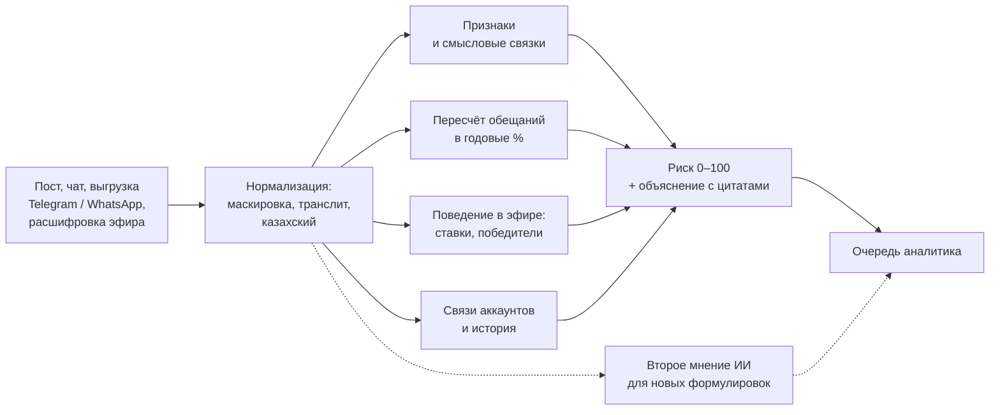

# Методика AlayakAlert

*Алаяқ* — по-казахски «мошенник». AlayakAlert — рабочее место аналитика. Он читает посты, переписки,
выгрузки чатов и расшифровки эфиров и отмечает признаки трёх видов схем: незаконных розыгрышей и лотерей,
скрытой рекламы онлайн-казино и финансовых пирамид.

**Главный принцип: система не объявляет схему незаконной.** Она показывает признаки, цитаты и расчёты
и ставит кейс в очередь на ручную проверку. Решает человек.

## 1. Идея: слова меняются, механика — нет

Мошенники быстро меняют слова: «к@зин0», транслит, казахский, эмодзи, новые эвфемизмы. Поэтому поиск по
запрещённым словам почти перестаёт работать (на нашем тесте с маскировкой — 6% найденных схем). Но саму
механику схемы скрыть нельзя:

- деньги идут от многих людей к одному;
- нужен способ заплатить — карта, Kaspi, номер телефона;
- обещают получить больше, чем отдал, или приз за плату;
- торопят и подтверждают «выплатами».

AlayakAlert ищет эту механику на шести уровнях.

## 2. Как устроена проверка

**Нормализация.** Текст приводится к одному виду: латинские буквы-двойники («KASPI» латиницей), цифры вместо
букв («п1рам1да»), разрядка («к а з и н о»), растянутые буквы, эмодзи, транслит. Цифры в суммах («500к»)
при этом не портятся.

**Признаки.** 41 признак по трём видам схем и 5 снижающих факторов. Каждый признак имеет вес: сильный — 30
баллов, средний — 15, слабый — 5. Примеры: «плата за участие», «плата за получение приза», «перевод на личную
карту», «промокод на казино», «вознаграждение за приглашённых», «плата за вывод денег», «гарантия дохода».

**Смысловые связки.** Отдельные слова мало что значат, поэтому система ищет сочетание смыслов в одном
сообщении: «заплати → получишь → больше», «вывод + комиссия + условие», «участие + деньги»,
«пригласи + доход + вклад». Учитываются отрицания: «это не казино» и «вы не получите» читаются правильно.

**Математика обещаний.** Любое обещание пересчитывается в годовые проценты: «вложи 20 000 — через 10 дней
получишь 50 000» — это тысячи процентов годовых. Больше 50% годовых — сильный признак. Скидки, кэшбэк,
курсы валют и рост акций не считаются обещанием дохода.

**Поведение в эфире.** Из расшифровки система сама находит ставки, победителей, приз и правила. Признаки:
последняя ставка в последние 15 секунд раунда в половине раундов и чаще (подставные ставки), один и тот же
победитель, собранный «банк» намного больше приза.

**Связи и история.** Аккаунты связываются общими телефонами, картами, промокодами, доменами, одинаковыми
скриншотами «выплат» и «победителями». Отслеживается воронка: сначала бесплатные раздачи и «прогрев»
(деньги случайным зрителям и переход в канал), потом платное участие.

**Длинные чаты.** Выгрузка режется на окна по 40 сообщений с шагом 20, итог — по худшему окну. Контекст
локальный: слово «розыгрыш» в одном сообщении не превращает чужой сбор денег в другом сообщении в лотерею.
Таблица «Кто пишет подозрительное» показывает баллы по каждому участнику.

**Снижающие факторы.** Предупреждения о мошенниках, обучение, официальные организации, лицензированные
финансовые компании, бесплатные розыгрыши снижают риск. Так честные тексты не попадают в очередь.

**Итог.** Баллы складываются в риск 0–100. Ключевые сочетания поднимают риск до минимума 70 (высокий) или 45
(стоит проверить). Уровни: до 40 — низкий, 40–69 — средний, 70 и выше — высокий. Карточка кейса
показывает каждый признак с цитатой и подсказку юристу: для лотерей без оператора — ч. 6 ст. 445-1 КоАП РК.

**Второе мнение ИИ.** В онлайн-версии языковая модель Claude независимо читает тот же текст и отвечает
«подозрительно / стоит проверить / признаков нет» с цитатами. Правила остаются главными: они объяснимы,
работают без интернета и не отправляют тексты наружу. ИИ ловит формулировки, которых нет в правилах.

## 3. Как мы измеряли качество

Мы старались измерять так, чтобы цифры нельзя было «подогнать».

- **Только вымышленные данные.** 298 синтетических кейсов (159 подозрительных, 139 честных) по мотивам
  открытых новостей о казахстанских схемах 2025–2026 годов. Телефоны, карты, аккаунты, бренды — вымышлены.
- **Обучение и тест написаны по-разному.** Тестовая часть (98 кейсов) — другим стилем: сленг, казахский,
  транслит.
- **Трудные честные примеры:** бесплатные розыгрыши, благотворительные аукционы, банковские депозиты,
  родительские сборы, новости и предупреждения.
- **Сравнение с простым решением:** словарь «два ключевых слова и больше».
- **Стресс-тест маскировки:** тексты теста испорчены приёмами мошенников.
- **Тексты команды.** Наборы, написанные участниками своими словами. Последний набор проверялся слепо:
  версия правил заморожена (отпечаток кода в истории git), один прогон, оценки сохранены до сверки,
  правила после не менялись.
- **Цифры записаны как есть**, включая слабые.

## 4. Результаты

**Синтетический тест (98 кейсов):**

| Метод | Точность (precision) | Полнота (recall) | Ложные срабатывания |
| --- | --- | --- | --- |
| Словарь | 87% | 39% | 7% |
| AlayakAlert | 98% | 92% | 2% |

**Маскировка:** словарь находит 39% → 6% схем, AlayakAlert — 92% → 85%.

**Скорость:** в чатах и эфирах высокий риск появляется в среднем на 2,8-м сообщении (26% разговора);
18 из 18 чатов пирамид помечены раньше первого «скриншота выплаты».

**Слепой набор команды (30 текстов: 15 схем, 15 честных):**

| Кто проверял | Найдено схем | Ложных тревог |
| --- | --- | --- |
| Правила | 9 из 15 | 0 из 15 |
| ИИ (первый запуск) | 15 из 15 | 0 из 15 |
| Правила или ИИ | 15 из 15 | 0 из 15 |

**Провокационные честные тексты (25 штук, похожих на схемы):** правила — 0 ложных тревог, ИИ — 1
(«стоит проверить» на оплате диагностики телефона).

**Выгрузки чатов (вымышленные):** «клуб инвесторов» в Telegram — высокий риск с 44-го сообщения из 50,
организатор первый в таблице авторов; «касса айналымы» в WhatsApp — высокий риск; честный родительский
чат из 100 сообщений — низкий риск.

## 5. Честные ограничения

- Данные синтетические. На реальном потоке цифры будут ниже, их нужно перепроверить на выборке,
  размеченной аналитиками.
- Правила пропускают короткие тексты с незнакомыми формулировками (6 из 15 в слепом наборе). Это закрывает
  второй слой ИИ, но его результат — один запуск на маленьком наборе, и набор для ИИ не полностью слепой.
- Сплошной транслит — слабое место правил (4 из 8).
- Система читает только текст. Фото, видео и голос — следующий этап (распознавание речи и текста на картинках).
- Система не подключается к платформам сама: материал приносит человек. Подключение — в плане внедрения.

## 6. Этика и безопасность

- Только открытые, синтетические или обезличенные данные; реальные имена и номера заменяются вымышленными.
- Система не обвиняет: формулировки — «признаки», «требуется проверка».
- Каждое решение объяснимо: признак, вес, цитата, расчёт.
- Проверка правилами идёт прямо в браузере или на сервере службы: текст никуда не отправляется. Браузерная
  копия движка даёт те же результаты, что и основная (проверено на 1708 входах, 0 расхождений).
- Кнопки «Подтвердить» и «Ложное срабатывание» собирают отметки аналитиков для улучшения правил.
